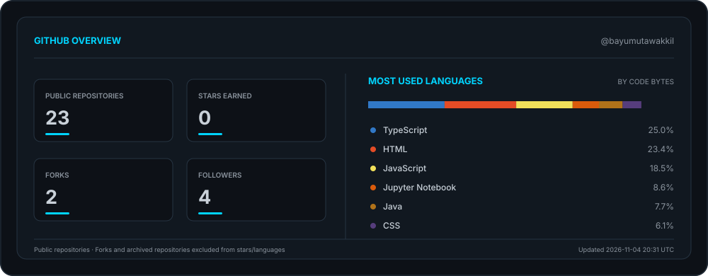

<div align="center">


<br/>


</div>

---

### so, who's this?

I'm an **Information Systems student at Universitas Andalas**. I like working out how a system runs from the inside, then building the thing that fixes what's annoying people.

I'm not just here for the code. I want to know *why* a process exists before I automate it.


```text
> interests:
    enterprise systems, ERP, business analysis
    data, machine learning, decision support
    databases, process modeling, the boring-but-critical bits
```


---

### tech stack

<div align="center">

<!-- SKILL_ICONS_START -->
typescript,html5,javascript,jupyter,openjdk,css3,python,gnubash
<!-- SKILL_ICONS_END -->

</div>

---


<div align="center">



<br/>


</div>

---

<div align="center">


<br/>

**thanks for stopping by. build something cool.** ✨


</div>